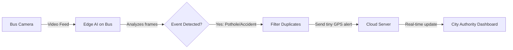

# MargDarshan AI - SIH Pitch Deck Content

*Note for Presenter: Keep your slides visual. Use these bullet points as your core text, but don't read them word-for-word. Let the text guide the audience while you tell the story.*

---

## Slide 1: IDEA TITLE - MargDarshan AI
**Transforming Public Transport into Smart Urban Sensors**

**Proposed Solution:**
*   **What it is:** We turn regular city buses into smart sensors. By running AI on existing bus dashcams, we automatically detect road defects, accidents, and traffic bottlenecks in real-time.
*   **How it addresses the problem:** Currently, authorities rely on delayed citizen complaints or fixed CCTVs with limited range. Our solution gives them a live, moving "pulse" of the entire city's road network directly on a central map.
*   **Innovation & Uniqueness:** Zero new infrastructure required. We process the video locally on the bus (Edge AI). Instead of uploading heavy video streams, we only send tiny text alerts (e.g., "Pothole at GPS location X"), saving massive bandwidth and cloud costs.

---

## Slide 2: TECHNICAL APPROACH
**Technologies & Workflow**

**Technologies Used:**
*   **Edge AI:** YOLOv8 (Custom trained models), ByteTrack, OpenCV, PyTorch.
*   **Backend:** FastAPI (Python), PostgreSQL (JSONB for dynamic data).
*   **Frontend Dashboard:** React 18, Leaflet.js (for GIS mapping), WebSockets (live alerts).

**Methodology & Process:**
*(Visual Idea: Put the flowchart below on the slide)*

---

## Slide 3: FEASIBILITY AND VIABILITY
**Why this will actually work in the real world.**

**Feasibility:**
*   Highly viable because it piggybacks on existing public transport networks. Minimal upfront hardware costs (CAPEX) since we don't need to install thousands of new poles and cameras.

**Potential Challenges & Risks:**
*   Hardware overheating or power limits on moving buses.
*   Unstable 4G/5G internet connectivity on certain routes.
*   AI struggling in poor visibility (heavy rain, fog, night).

**Mitigation Strategies:**
*   **Hardware:** Use lightweight AI models optimized for low-power edge devices.
*   **Connectivity:** "Store and Forward" - if the internet drops, the system saves alerts locally and syncs to the cloud once the signal returns.
*   **Accuracy:** Train our models specifically on diverse Indian weather conditions and road datasets to reduce false positives.

---

## Slide 4: IMPACT AND BENEFITS
**Creating a Safer, Smarter City**

**Impact on Target Audience:**
*   **City Authorities:** Proactive maintenance instead of reactive patching. Eliminates the need for expensive manual road surveys.
*   **Citizens:** Smoother, safer commutes with fewer accidents and less congestion.

**Core Benefits:**
*   **Economic:** Saves millions by fixing minor road damages before they expand, and removes the need to buy and maintain a massive new CCTV network.
*   **Social & Safety:** Automatic hit-and-run detection with license plate tracking ensures faster emergency response and accountability. 
*   **Environmental:** Identifying and fixing traffic bottlenecks reduces vehicle idling time, lowering urban carbon emissions.

---

## Slide 6: RESEARCH AND REFERENCES
**Data-Backed Execution**

**Research Insights:**
*   India records severe road fatalities annually; poor infrastructure (potholes, missing signage) and delayed emergency response are major contributing factors. 
*   Existing fixed CCTV networks cover less than 20% of total road length in major cities.

**Technical References:**
*   **AI Models:** Built upon the Ultralytics YOLOv8 architecture for real-time object detection.
*   **Tracking:** Implementing ByteTrack algorithms for multi-object trajectory analysis.
*   **Datasets:** Custom-annotated Roboflow datasets targeting Indian road conditions and vehicular traffic.
*   **Mapping Integration:** OpenStreetMap & Leaflet.js for accurate geospatial plotting.
