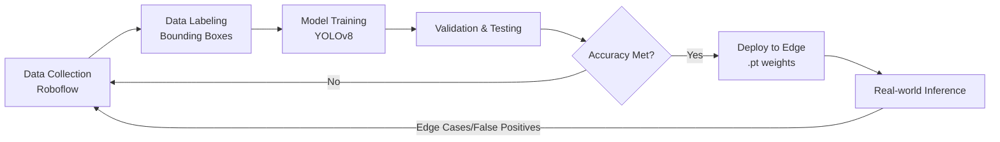

# Comprehensive Technology Stack & Data Workflow

This document provides an in-depth breakdown of the technologies used in the Mobile Urban Sensing Intelligence Platform, the role of each component, the step-by-step data pipeline, data storage mechanisms, and security measures.

## 1. Technologies Used & Their Roles

The system is built on a modern, decoupled architecture consisting of Edge AI, a robust backend, and an interactive frontend.

### Frontend (Client-Side)
*   **React 18**: The core JavaScript library used to build the interactive user interface. It handles state management and renders the dashboard efficiently.
*   **Vite**: The build tool and development server, chosen for its extremely fast Hot Module Replacement (HMR) and optimized build process.
*   **Framer Motion**: Used for smooth, modern animations and transitions within the dashboard to provide a premium user experience.
*   **Leaflet.js**: A lightweight JavaScript library used for mapping. It renders the interactive GIS (Geographic Information System) map, plotting incidents using GPS coordinates.
*   **Recharts**: Used for rendering data analytics charts, such as congestion metrics and road health scores over time.

### Backend (Server-Side)
*   **Python**: The primary programming language for both the backend server and AI processing, chosen for its vast ML ecosystem and rapid development capabilities.
*   **FastAPI**: A modern, high-performance web framework for Python. It handles RESTful API requests from the frontend and manages WebSocket connections for real-time data streaming.
*   **SQLAlchemy**: The Python SQL toolkit and Object Relational Mapper (ORM), used to interact with the PostgreSQL database securely and efficiently.
*   **WebSockets**: Enables bi-directional, real-time communication between the edge AI pipeline and the frontend dashboard for live detection feeds and instant alerts.

### AI & Machine Learning (Edge Processing)
*   **Ultralytics (YOLOv8)**: The core object detection framework. Multiple YOLOv8 models are used (General COCO, Potholes, Road Damage, ANPR) to accurately detect and classify entities in real-time.
*   **ByteTrack**: A multi-object tracking algorithm. It assigns unique IDs to detected objects across video frames, allowing the system to track trajectories (e.g., a vehicle's path).
*   **OpenCV**: Used for video stream capture (RTSP/WebRTC), frame manipulation, and rendering bounding boxes/overlays before they are streamed.
*   **PyTorch (with CUDA)**: The deep learning framework that powers YOLOv8. CUDA enables hardware acceleration on Nvidia GPUs, critical for processing video streams at high FPS on the edge.

### Database & Storage
*   **PostgreSQL**: A powerful, open-source relational database system used as the primary data store.
*   **JSONB (PostgreSQL Feature)**: Used within PostgreSQL to store unstructured or highly dynamic event metadata (e.g., varying attributes of different types of incidents).

---

## 2. End-to-End Data Workflow (Step-by-Step)

The data flows from raw video capture on the bus to actionable insights on the centralized dashboard.

```mermaid
flowchart TD
    subgraph Edge Device (Bus)
        A[IP Camera / Dashcam] -->|RTSP / WebRTC Stream| B(Data Ingestion)
        B -->|Raw Frames| C{AI Detection Layer\nYOLOv8}
        C -->|Bounding Boxes, Classes| D[Multi-Object Tracking\nByteTrack]
        D -->|Trajectories, IDs| E(Intelligence & Event Fusion Layer)
    end
    
    subgraph Cloud Server
        E -->|Confirmed JSON Payload\nOver HTTPS/WebSocket| F[FastAPI Backend]
        F --> G[(PostgreSQL DB)]
    end
    
    subgraph Client / Admin
        F -.->|Real-time WebSocket| H[React Dashboard]
        G -->|API Fetch| H
        H -->|Render| I[GIS Map & Reports]
    end
```

### Step 1: Data Ingestion (Edge)
*   **What happens:** Video feeds are captured from onboard cameras (via RTSP for IP cameras or WebRTC for dashcams).
*   **Processing:** The system extracts individual frames from the continuous video stream. To save bandwidth, this happens locally on the edge device (the bus).

### Step 2: Detection & Classification
*   **What happens:** Frames are passed through a multi-model YOLOv8 ensemble.
*   **Processing:**
    *   The *General Model* finds vehicles and pedestrians.
    *   *Custom Models* look for road defects (potholes, waterlogging, signage).
    *   The *ANPR Model* scans for license plates if a vehicle is detected in a relevant incident.

### Step 3: Multi-Object Tracking
*   **What happens:** Bounding boxes from the current frame are linked to objects in previous frames using ByteTrack.
*   **Processing:** Every vehicle/person is assigned a persistent `track_id`, establishing continuous movement trajectories (speed and direction).

### Step 4: Intelligence & Event Fusion (The Brain)
*   **What happens:** Trajectories and detections are analyzed over time.
*   **Processing:**
    *   **Logic Evaluation:** The system checks for specific conditions (e.g., sudden speed drop + bounding box intersection = Collision, swerving = Rash Driving).
    *   **Debouncing (Event Fusion):** The system deduplicates events. If a pothole is visible for 5 seconds (150 frames), it groups these into a *single* high-confidence event rather than spamming the database.

### Step 5: Data Transmission & Storage
*   **What happens:** Once an event is confirmed and debounced, the edge device creates a lightweight JSON payload (Event Type, GPS, Timestamp, Confidence, Severity, License Plate if applicable).
*   **Processing:** This small text payload is sent via secure API to the cloud FastAPI backend, which saves it permanently in the PostgreSQL database.

### Step 6: Centralized Reporting & Dashboard
*   **What happens:** The React frontend fetches historical data via REST APIs and receives live alerts via WebSockets.
*   **Processing:** Data is rendered visually on the Leaflet GIS map, color-coded by severity, allowing authorities to view actionable reports.

---

## 3. Data Storage & Protection

Given the sensitive nature of traffic and potential personal data (e.g., license plates), robust data management is required.

### Data Storage Architecture
*   **Structured Data:** Core event attributes (ID, timestamp, location, primary event type) are stored in standard PostgreSQL relational columns for fast indexing and GIS querying.
*   **Unstructured Metadata:** Specific details (e.g., AI confidence scores, varied attributes for a pothole vs. a hit-and-run) are stored in JSONB columns, allowing flexibility without altering database schemas.

### Data Protection & Privacy Measures
*   **Edge Processing Minimization:** The most significant privacy feature is that **raw video is rarely sent to the cloud**. Only metadata (text descriptions of events, GPS, timestamps) is transmitted. This drastically reduces the risk of mass surveillance data leaks.
*   **Encryption in Transit:** All data sent from the edge device to the backend, and from the backend to the frontend dashboard, is secured using TLS/HTTPS and Secure WebSockets (WSS).
*   **Encryption at Rest:** The PostgreSQL database is configured to encrypt data at rest on the storage volume.
*   **Authentication & Authorization:** The FastAPI backend implements JWT (JSON Web Tokens) or OAuth2 to ensure only authorized city officials can access the dashboard and APIs.

---

## 4. Methodology and Process

The development and deployment lifecycle follows an iterative AI workflow.



1.  **Dataset Aggregation:** Collecting diverse images of Indian roads, vehicles, and defects using tools like Roboflow.
2.  **Annotation:** Manual labeling of bounding boxes around classes of interest (potholes, license plates, etc.).
3.  **Model Training:** Utilizing automated scripts (`train_potholes.py`, etc.) to fine-tune YOLOv8 models on custom datasets using PyTorch and GPU acceleration.
4.  **Integration & Testing:** Loading the compiled `.pt` weights into the pipeline and testing against pre-recorded local videos.
5.  **Deployment:** Deploying the Python application and models to the edge devices (buses).
6.  **Continuous Improvement:** False positives or undetected edge cases from the real world are fed back into the dataset for the next training iteration (Active Learning Loop).
